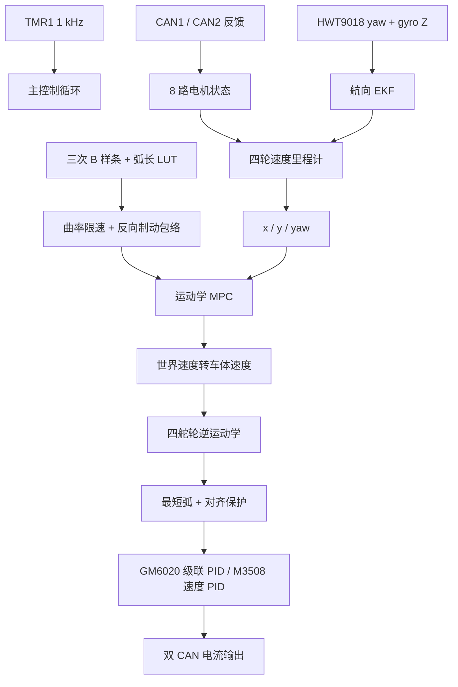

<div align="center">

<h1>AT32 四舵轮 MPC 自动导航</h1>

<p><strong>三次 B 样条路径 · 曲率预减速 · 轻量化运动学 MPC · 轮惯融合里程计</strong></p>

<p>
  
  
  
  
  
</p>

</div>

这是一套面向四舵轮底盘的裸机自动导航固件。系统在 1 kHz 主控制节拍下完成双 CAN 电机反馈、遥控解析、四舵轮解算和电机闭环；导航层按独立周期运行 B 样条路径采样、融合里程计、速度规划与 MPC 求解。

当前版本是一份可继续实车调参的开发基线。它强调可诊断和可回退：关键状态均能在调试器中观察，MPC 求解失败会回退到前瞻控制，也可通过一个宏完整关闭 MPC。

## 功能亮点

- 四舵轮运动学：四个 GM6020 控制转向，四个 M3508 控制驱动。
- 转向最短弧优化：目标角超过 90° 时翻转轮速，减少舵轮旋转行程。
- 舵向动态滤波与对齐保护：转向误差过大时限制驱动输出，降低侧滑和突跳风险。
- 三次 B 样条路径：9 个控制点生成心形闭合轨迹，并用 128 段查找表按弧长采样。
- 曲率感知速度规划：同时考虑全局速度、横向加速度和终点制动距离。
- 轻量化 MPC：使用二维运动学模型、固定预测域和投影梯度迭代，适合资源受限 MCU。
- 三状态航向 EKF：融合轮速角速度、HWT9018 陀螺与低增益航向锚定，估计 yaw、yaw rate 和 gyro bias。
- 自动/手动仲裁：检测到非零遥控输入后退出自动导航，将控制权交回操作者。
- 故障闭环：IMU 超时、运行超时、非法输出和正常完成均有独立停车原因锁存。

## 控制链路



## 算法实现

### 1. B 样条路径与弧长采样

`path_planner.c` 使用三次、夹持节点 B 样条生成路径。控制点先以归一化心形模板保存，再按前向尺度、横向半宽和起始航向变换到世界坐标。初始化时建立弧长查找表，运行时可通过累计距离直接获得位置、切向量、曲率和参考速度。

关键入口：

- `PathPlanner_BuildHeartBSpline()`：生成路径与弧长 LUT。
- `PathPlanner_SampleByDistance()`：按距离采样参考状态。
- `PathPlanner_FindNearestDistance()`：根据当前位姿更新路径进度。

### 2. 曲率速度剖面

路径的瞬时速度上限同时受到三类约束：

```text
v_ref = min(v_global, sqrt(a_lateral / |curvature|), v_braking)
```

初始化阶段先计算各 LUT 点的曲率限速，再从终点反向传播制动包络。这样即使 MPC 的预测时间较短，也能在急弯和终点之前提前收到较低的参考速度。

### 3. MCU 上的轻量化 MPC

控制器以世界坐标下的二维位置为状态、二维平移速度为控制量，预测域为 5 步。代价函数区分沿路径方向与横向方向误差，并加入速度幅值、速度变化和终端误差惩罚。每次使用固定 5 次投影梯度迭代，将候选控制量限制在最大速度和最大加速度范围内。

这不是依赖通用 QP 库的桌面 MPC，而是针对当前 MCU、控制周期和全向底盘运动学做的固定规模实现。

### 4. 航向与里程计融合

`odometry.c` 从四个驱动轮 RPM 和当前舵向恢复车体速度与轮速角速度，再将速度旋转到世界坐标积分位置。航向滤波状态为：

```text
[ yaw, yaw_rate, gyro_bias ]
```

轮速角速度和陀螺 Z 作为快速观测，HWT9018 yaw 以低增益锚定长期方向。代码还保留 HWT、EKF 和纯陀螺三套影子里程计量，便于定位误差来源。

## 当前参数快照

以下数值来自本分支提交时的源码，只代表当前实车开发基线：

| 参数 | 当前值 | 位置 |
| --- | ---: | --- |
| 自动启动延时 | 5000 ms | `inc/navigation.h` |
| 心形前向尺度 | 3000 mm | `inc/navigation.h` |
| 心形半宽 | 1500 mm | `inc/navigation.h` |
| 导航最高速度 | 1500 mm/s | `inc/navigation.h` |
| MPC 预测步数 | 5 | `src/navigation.c` |
| MPC 求解周期 | 20 ms | `src/navigation.c` |
| MPC 最大加速度 | 1.2 m/s² | `src/navigation.c` |
| 曲率横向加速度上限 | 800 mm/s² | `src/navigation.c` |
| B 样条 LUT | 128 段 | `inc/path_planner.h` |

> 路径尺度不是实车最终位移的直接保证。轮径、减速比、地面摩擦、舵向零位、路径进度估计和高速动态误差都会影响实际轨迹，必须通过固定基准进行实测标定。

## 目录与职责

| 文件 | 职责 |
| --- | --- |
| `src/main.c` | 系统初始化、1 kHz 控制调度、自动/手动仲裁、CAN 收发 |
| `src/navigation.c` | 导航状态机、速度剖面、MPC、前瞻回退、终点控制 |
| `src/path_planner.c` | B 样条生成、弧长 LUT、曲率和最近进度搜索 |
| `src/odometry.c` | 四舵轮里程计、航向 EKF、诊断影子积分 |
| `src/chassis.c` | 舵轮逆运动学、最短弧、舵向滤波、对齐限速 |
| `src/hwt9018.c` | HWT9018 UART5 配置、帧解析、陀螺偏置与航向零位 |
| `src/can.c` | CAN1/CAN2 初始化、电机命令与反馈映射 |
| `src/motor.c`, `src/pid.c` | 电机状态、GM6020 级联控制、M3508 速度闭环 |
| `src/remote.c` | 遥控数据解析 |

## 构建

### 环境

- Keil MDK5
- Arm Compiler 5
- AT32F403A/407 Firmware Library
- 对应芯片支持包与下载器

### 步骤

1. 打开 `mdk_v5/duolun_test.uvprojx`。
2. 选择 `template` Target。
3. 在工程设置中更新 AT32 `drivers`、`CMSIS` 与 startup 文件路径。当前工程文件保留了开发机上的绝对库路径，克隆到新电脑后必须重定向。
4. Build 并确认生成当前时间戳的 AXF/HEX。
5. 下载前核对双 CAN 电机 ID、正负方向、舵向零位、轮径与底盘半径。

仓库仅提交工程源文件，不提交 `Objects/`、`Listings/`、AXF、映射文件和本地调试日志。

## MPC 回退与关键调试量

如需回到原前瞻路径跟踪器：

```c
#define NAV_PATH_TRACKER_MPC_ENABLE 0U
```

常用调试量：

| 变量 | 含义 |
| --- | --- |
| `g_navigation_mpc_active` | 当前是否输出 MPC 结果 |
| `g_navigation_mpc_fallback` | MPC 是否进入前瞻回退 |
| `g_navigation_mpc_cross_error_mm` | MPC 参考系下横向误差 |
| `g_navigation_mpc_reference_speed_m_s` | 当前速度剖面参考值 |
| `g_navigation_mpc_solve_cycles_max` | MPC 求解最大 DWT 周期数 |
| `g_navigation_stop_reason_latched` | 停车原因：1 IMU、2 超时、3 非法输出、4 完成 |
| `g_odometry_ekf_yaw_deg` | 融合航向 |
| `g_odometry_shadow_max_abs_yaw_diff_deg` | HWT yaw 与 EKF 最大差异 |

## 实车调试建议

1. 先架空确认八路电机 ID、反馈方向和急停链路。
2. 固定车身朝向，分别验证正向、横移和旋转的坐标符号。
3. 用直线定长基准标定轮径与前向/横向里程系数。
4. 低速验证完整路径，再一次只修改一个参数。
5. 每次修改后依次区分：源码、Build 产物、下载固件、实车结果。
6. 提速时同时观察路径是否被切角、舵轮对齐比例和 MPC 求解时间，不只看终点误差。

## 已知边界

- 当前是相对定位方案，没有 GNSS、视觉或外部定位提供绝对位置闭环，长距离误差仍会累积。
- MPC 使用简化二维运动学模型，没有显式建模轮胎侧滑、电机滞后和舵向动态。
- 当前心形路径和高速参数仍属于实车调试对象，换底盘或地面后不能直接复用精度结论。
- 工程依赖外部 AT32 固件库，首次构建需要调整 Keil 中的库文件路径。

---

<div align="center">
  <sub>建议从低速、固定起点和单变量测试开始，让每一次参数变化都有可解释的实车证据。</sub>
</div>
