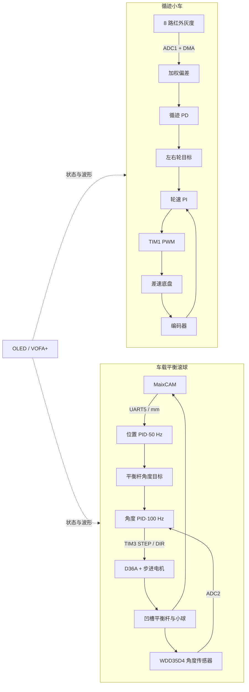

<div align="center">

# 车载平衡滚球运动控制系统（H题）

### 2026 年全国大学生电子设计竞赛赛区赛（TI 杯）

[](#)
[](#)
[](#)
[](#)
[](#)

**循迹小车 × 视觉定位 × 平衡杆 × 级联控制**

</div>

> 设计制作一辆载有平衡滚球运动控制装置的循线小车，小车沿场地黑色引导线运动，同时控制小球在凹槽平衡杆上指定位置稳定。

本分支收录 H 题工程的 STM32 底层控制、红外循迹、编码器闭环、MaixCAM 小球视觉定位、平衡杆角度采集和步进电机控制代码。为避免误导，下文将“赛题指标”与“当前代码状态”分开说明。

## 系统亮点

- **8 路红外灰度循迹**：PA0–PA7 由 ADC1 + DMA 循环采样，通过归一化加权偏差与 PD 完成路径跟踪。
- **车轮速度闭环**：双路编码器反馈 + PI 调速，将循迹输出转换为左右轮速目标。
- **视觉小球定位**：MaixCAM 基于 LAB 色块提取小球中心，标定后输出带符号位置（mm）。
- **双环平衡控制**：外环位置 PID 生成平衡杆角度目标，内环角度 PID 控制步进电机频率与方向。
- **可观测与可调试**：OLED 显示关键状态，VOFA+ 输出循迹、轮速和滚球控制变量。

## 控制架构



## 官方赛题指标

> 以下是题目要求，不代表当前代码已完成或已经实测达标。

| 项目 | 主要要求 | 分值 |
|---|---|---:|
| 车载视频监测 | 实时传输、显示、存储和回放平衡杆上的小球运动情况 | 6 |
| 单圈循迹 | 从 A 点启动，顺时针一圈后停在 A 点；用时 ≤ 20 s，停车误差 ≤ 2 cm | 16 |
| 静态定点控球 | 小球由 O 点依次运动到 **+5 cm、-5 cm** 并稳定；各段用时 ≤ 5 s，最大绝对误差 ≤ 1 cm | 13 |
| A 到 B 运动控球 | 用时 ≤ 8 s，运动中小球中心与 O 点距离 ≤ 1 cm | 20 |
| 单圈中心平衡 | 完成一圈 ≤ 30 s，全程小球中心误差 ≤ 1 cm | 20 |
| 单圈指定位置平衡 | 完成一圈 ≤ 30 s，小球在平衡杆上指定位置稳定，误差 ≤ 1 cm | 20 |
| 其他发挥 | 其他创新或扩展功能 | 5 |

设计报告 20 分，基本要求与发挥部分 100 分，总分 120 分。

### 场地与装置约束

- 场地引导线为黑色，线宽 `1.8 ± 0.2 cm`；AB、CD 直线段各 `1.5 m`，BC、DA 为半径 `0.5 m` 的半圆。
- 小车长宽不大于 `35 cm × 25 cm`，循迹只能使用红外光电模块。
- 运行期间不得遥控或人工干预，车载显示屏不大于 2 英寸。
- 平衡杆长 25 cm，采用 PPR 管制作；小球位置必须由摄像头检测。

## 当前代码状态

| 模块 / 赛题项 | 状态 | 说明 |
|---|---|---|
| 8 路循迹 + 轮速闭环 | 已有完整代码链 | ADC/DMA、加权偏差、PD、编码器、轮速 PI 和完成检测均已实现 |
| MaixCAM 小球位置检测 | 已实现 | Python 脚本完成 LAB 色块检测，通过 UART 向 STM32 发送 mm 位置 |
| 静态平衡滚球 | 控制链已实现 | 位置外环 + 角度内环 + 步进电机脉冲输出；默认仍处于安全监测模式 |
| 视频传输、存储、回放 | 未完整集成 | 当前 MaixCAM 脚本主要负责定位与本地画面叠加 |
| 行车与控球同时运行 | 待整合 | 当前通过编译期任务宏切换循迹或静态控球，赛题第 4–6 项尚未形成同时闭环 |

> [!IMPORTANT]
> 题目要求的静态路径是 `O → +5 cm → -5 cm`；当前 `ball_config.h` 中的源码状态机是 `O → -5 cm → +5 cm`。本分支保留了用户原始代码，未擅自改参数或控制逻辑。

> [!CAUTION]
> `BALL_CONTROL_MODE` 默认为 `BALL_MODE_SENSOR_MONITOR`，步进电机不会被主动驱动。在机械限位、方向、零点和急停措施未确认前，不要直接切换到闭环模式。

## 软硬件组成

| 功能 | 器件 / 外设 | 主要接口 |
|---|---|---|
| 主控 | STM32F407ZGT6，168 MHz | HAL / CubeMX |
| 8 路灰度 | 红外光电传感器 | PA0–PA7，ADC1 + DMA，TIM8 触发 |
| 左右轮 PWM | 电机驱动 | TIM1 CH1 / CH2 |
| 左右编码器 | 增量式编码器 | TIM2 / TIM4 |
| 电机方向 | GPIO | PE8、PE10、PE12、PE14 |
| 平衡杆角度 | WDD35D4 | PB0，ADC2_IN8 |
| 步进驱动 | D36A | PC6 / TIM3_CH1 STEP，PC8 DIR，PB14 EN |
| 小球视觉 | MaixCAM | UART5 RX（PD2），115200 baud |
| OLED | I²C 显示 | PB6 / PB7，I2C1 |
| VOFA+ | 调试数据 | USART3，PB10 / PB11 |
| 按键 / 状态输入 | 启动、完成、模式 | PG0–PG3 |

## 仓库结构

```text
02_Car_Balance_Ball_Control_System/
├── Core/
│   ├── Inc/                      # 应用配置、循迹、底盘、滚球控制头文件
│   └── Src/                      # STM32 主程序与控制实现
├── Drivers/                       # STM32 HAL / CMSIS
├── MaixCAM/
│   └── maixcam_ball.py           # 小球检测、标定与 UART 位置输出
├── MDK-ARM/
│   └── diansai.uvprojx           # Keil MDK 工程
├── diansai.ioc                    # STM32CubeMX 配置
└── THIRD_TASK_README.md           # 原有静态控球调试说明
```

## 快速开始

```bash
git clone https://github.com/lzy9760/STM32-Project.git
cd STM32-Project
git checkout diansai_2026
cd 02_Car_Balance_Ball_Control_System/MDK-ARM
```

1. 用 Keil MDK 打开 `diansai.uvprojx`。
2. 选择 Target `diansai`。
3. 确认当前编译器与芯片设置后执行 Build。
4. MaixCAM 端打开 `MaixCAM/maixcam_ball.py`，根据实际相机、小球颜色和尺度重新标定。

当前分支已使用 **Arm Compiler 5.06 update 5 (build 528)** 完成本地编译检查：

```text
Program Size: Code=19158 RO-data=674 RW-data=256 ZI-data=2792
0 Error(s), 0 Warning(s)
```

> 编译通过只能说明源码与工程配置可生成固件，不等于实车已经达到赛题时间和误差指标。

## 建议调试顺序

1. **传感器监测**：保持 `BALL_MODE_SENSOR_MONITOR`，先确认角度零点、滤波后角度和 MaixCAM 位置符号。
2. **开环方向测试**：低频短时驱动步进电机，确认正负方向、使能电平和机械限位。
3. **角度内环**：断开位置外环，先让平衡杆对小角度阶跃稳定跟踪。
4. **位置外环**：从中心位置和小幅目标开始，逐步放开角度、频率与积分限幅。
5. **系统整合**：使静态控球可重复后，再整合底盘运动、加速度前馈和任务状态机。

## 开源与贡献

本分支优先保留可追溯的 CubeMX 工程、STM32 源码与 MaixCAM 脚本，不提交 Keil 中间产物和临时调试文件。欢迎针对循迹鲁棒性、视觉延迟补偿、双环参数整定以及行车—控球联合状态机提交改进。

---

<div align="center">

**让小车按路径走，也让小球在运动中站稳。**

</div>
