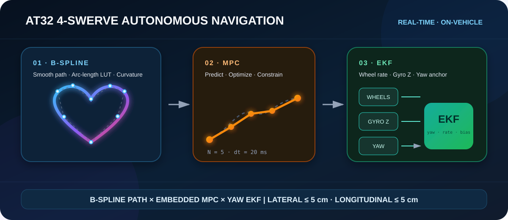
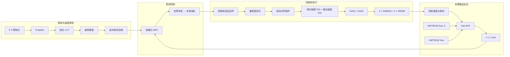

<div align="center">

<h1>AT32 四舵轮自主导航系统</h1>

<h3>B-Spline × MPC × EKF</h3>

<p>一套真正运行在实车上的路径生成、预测控制、轮惯融合与八电机闭环方案</p>

<p>
  
  
  
  
</p>

<table>
  <tr>
    <td align="center"><strong>≤ 5 cm</strong><br/>横向终点误差</td>
    <td align="center"><strong>≤ 5 cm</strong><br/>纵向终点误差</td>
    <td align="center"><strong>20 ms</strong><br/>MPC 求解周期</td>
    <td align="center"><strong>1 kHz</strong><br/>底盘控制节拍</td>
  </tr>
</table>

<p>
  
</p>

<p>
  <a href="#三大核心算法">核心算法</a> ·
  <a href="#完整控制闭环">系统架构</a> ·
  <a href="#实车结果">实车结果</a> ·
  <a href="#快速开始">快速开始</a> ·
  <a href="01_Car_Swerve_Wheels_AutoNavigation/README.md">完整技术文档</a>
</p>

</div>

---

## 项目简介

这不是只在 MATLAB 中绘制理想曲线的算法 Demo，而是一套落到 AT32F403A 和四舵轮实车上的完整导航控制链：

```text
三次 B 样条生成轨迹
        ↓
曲率限速与前瞻制动
        ↓
轻量化运动学 MPC 预测控制
        ↓
EKF 融合轮速、陀螺与航向角
        ↓
四舵轮逆运动学与八电机 PID
        ↓
双 CAN 驱动 GM6020 + M3508
```

当前版本已经完成心形闭合轨迹实车测试。在当前底盘、地面和标定参数下，横向与纵向终点误差均可控制在 **5 cm 以内**。

## 三大核心算法

<table>
  <tr>
    <td width="33%" valign="top">
      <h3>① Cubic B-Spline</h3>
      <p><strong>连续、平滑、可按弧长采样</strong></p>
      <p>9 个控制点构造心形闭合轨迹，128 段 LUT 建立参数与路径距离映射，同时输出位置、切向量和曲率。</p>
      <p><code>path_planner.c</code></p>
    </td>
    <td width="33%" valign="top">
      <h3>② Embedded MPC</h3>
      <p><strong>提前看见误差，而不是事后追赶</strong></p>
      <p>二维运动学模型、5 步预测域、投影梯度迭代，并显式限制速度和加速度；求解失败可自动回退。</p>
      <p><code>navigation.c</code></p>
    </td>
    <td width="33%" valign="top">
      <h3>③ Yaw EKF</h3>
      <p><strong>让轮速和 IMU 各自做擅长的事</strong></p>
      <p>融合轮速角速度、HWT9018 gyro Z 与低增益 yaw 锚定，联合估计航向、角速度和陀螺零偏。</p>
      <p><code>odometry.c</code></p>
    </td>
  </tr>
</table>

## 完整控制闭环



## 为什么选择 B 样条

相比直接连接离散航点，三次 B 样条能够在控制点之间生成连续曲线，并保持较好的局部可调性。代码使用夹持节点向量和 De Boor 递推计算路径：

```math
\mathbf{C}(u)=\sum_{i=0}^{n}N_{i,3}(u)\mathbf{P}_i
```

初始化阶段完成三件事：

1. 将归一化控制点按路径长度、宽度和起始航向变换到世界坐标。
2. 建立 128 段弧长查找表，使控制器可以按“走了多少毫米”采样路径。
3. 通过邻域切向量估计曲率，为高速转弯前的速度规划提供依据。

当前心形轨迹的控制点模板：

```text
Start ──╮      ╭── Right lobe
        ╰╮    ╭╯
         ╲╲  ╱╱
          ╲╲╱╱
           ╲╱       ← heart tip
           ╱╲
          ╱  ╲
         ╰────╯      ← closed path returns to Start
```

## MPC 如何在 MCU 上运行

MPC 使用世界坐标中的二维位置作为预测状态，二维平移速度作为控制输入：

```math
\mathbf{p}_{k+1}=\mathbf{p}_k+\Delta t\,\mathbf{u}_k
```

代价函数分别惩罚沿路径误差、横向误差、控制量变化和终端误差：

```math
J=\sum_{k=1}^{N}\left(q_a e_{a,k}^2+q_c e_{c,k}^2+r_v\|\mathbf{u}_k-\mathbf{u}_{ref,k}\|^2+r_{\Delta u}\|\Delta\mathbf{u}_k\|^2\right)+J_N
```

工程上采用固定规模设计：

- 预测域 `N = 5`，模型步长 `20 ms`。
- 每次固定进行 5 次投影梯度迭代，无需通用 QP 求解库。
- 候选速度同时投影到最高速度和最大加速度约束内。
- 曲率速度剖面提前限制急弯参考速度，弥补短预测域的空间预见距离。
- `NAV_PATH_TRACKER_MPC_ENABLE` 设为 `0U` 即可恢复原前瞻跟踪器。

## EKF 如何抑制航向漂移

滤波器状态为：

```math
\mathbf{x}=[\psi,\ \dot{\psi},\ b_g]^T
```

其中 `yaw` 描述车体航向，`yaw_rate` 描述转动速度，`gyro_bias` 在线估计陀螺零偏。系统使用：

- 四轮速度与舵向解算的角速度作为车辆运动观测。
- HWT9018 gyro Z 作为快速动态观测。
- HWT9018 yaw 作为受限、低增益的长期航向锚点。
- NIS 与硬门限拒绝异常测量，避免单帧跳变直接污染位姿。
- HWT、EKF、纯陀螺三套影子积分量用于定位误差来源。

## 实车结果

| 测试项目 | 当前结果 |
| --- | ---: |
| 横向终点误差 | **≤ 5 cm** |
| 纵向终点误差 | **≤ 5 cm** |
| 测试轨迹 | 三次 B 样条心形闭合轨迹 |
| 车身策略 | 路径过程中保持初始航向，终点独立回正 |
| 控制器 | 轻量化运动学 MPC，异常时前瞻回退 |

> 以上是当前实车、当前标定和测试场地下获得的结果，不代表所有底盘、速度与地面条件下的理论保证。复现时需要重新校准轮径、舵向零位、IMU 朝向和里程计比例。

## 关键工程能力

- **八电机闭环**：四个 GM6020 转向电机 + 四个 M3508 驱动电机。
- **双 CAN 总线**：CAN1/CAN2 均以 1 Mbps 工作，分担电机反馈与控制。
- **转向最短弧**：舵向误差超过 90° 时反转驱动方向，减少转向时间。
- **对齐保护**：舵轮未对准目标角时主动限制驱动输出。
- **遥控接管**：检测到人工速度输入后退出自动导航。
- **安全停车**：IMU 超时、运行超时、非法输出、正常完成分别锁存原因。
- **可观测调试**：MPC 代价、横向误差、参考速度、求解周期和 EKF 创新量可直接查看。

## 代码入口

| 模块 | 主要内容 |
| --- | --- |
| [`path_planner.c`](01_Car_Swerve_Wheels_AutoNavigation/src/path_planner.c) | B 样条、De Boor 计算、弧长 LUT、曲率与进度搜索 |
| [`navigation.c`](01_Car_Swerve_Wheels_AutoNavigation/src/navigation.c) | MPC、速度包络、路径跟踪、状态机和终点控制 |
| [`odometry.c`](01_Car_Swerve_Wheels_AutoNavigation/src/odometry.c) | 四舵轮里程计、三状态 yaw EKF、影子积分诊断 |
| [`chassis.c`](01_Car_Swerve_Wheels_AutoNavigation/src/chassis.c) | 四舵轮逆运动学、舵向滤波、最短弧和对齐保护 |
| [`hwt9018.c`](01_Car_Swerve_Wheels_AutoNavigation/src/hwt9018.c) | IMU 配置、UART 帧解析、航向零位和陀螺偏置 |
| [`main.c`](01_Car_Swerve_Wheels_AutoNavigation/src/main.c) | 1 kHz 主循环、双 CAN、自动/手动控制仲裁 |

## 快速开始

```bash
git clone https://github.com/lzy9760/STM32-Project.git
cd STM32-Project/01_Car_Swerve_Wheels_AutoNavigation/mdk_v5
```

1. 使用 Keil MDK5 打开 `duolun_test.uvprojx`。
2. 安装 Arm Compiler 5 和 AT32F403A/407 固件库。
3. 将工程内 AT32 `drivers`、`CMSIS`、startup 的绝对路径改成你的本机位置。
4. 选择 `template` Target 并 Build。
5. 下载前核对电机 ID、双 CAN 映射、驱动方向、转向零位、轮径和底盘半径。

当前提交使用 Arm Compiler `V5.06 update 5` 验证通过：

```text
0 Error(s), 2 Warning(s)
```

两条警告来自关闭在线速率标度估计后保留的未使用统计变量，不影响固件链接。

## 当前导航参数

| 参数 | 当前值 |
| --- | ---: |
| 自动启动延时 | 5000 ms |
| 路径前向尺度 | 3000 mm |
| 路径半宽 | 1500 mm |
| 导航最高速度 | 1500 mm/s |
| MPC 最大加速度 | 1.2 m/s² |
| 曲率横向加速度上限 | 800 mm/s² |
| B 样条弧长 LUT | 128 段 |

完整参数、调试变量、回退方法和实车检查流程见 [四舵轮项目技术文档](01_Car_Swerve_Wheels_AutoNavigation/README.md)。

## 仓库中的其他工程

| 目录 | 内容 |
| --- | --- |
| [`00_Car_Mecanum_Wheels_AutoNavigation/`](00_Car_Mecanum_Wheels_AutoNavigation/) | STM32F407 麦克纳姆轮自动导航工程 |
| [`00_Remote_NRF_Controller/`](00_Remote_NRF_Controller/) | NRF 遥控端工程 |
| [`00_Firmware_HEX/`](00_Firmware_HEX/) | 已发布固件 |
| [`docs/mecanum-navigation-technical-report.md`](docs/mecanum-navigation-technical-report.md) | 原麦轮自动导航技术报告 |

## 使用前注意

- 自动导航属于实验性功能，首次运行请架空车轮或设置物理急停，并从低速开始。
- 不要直接复用本项目的电机方向、舵向零位和坐标符号到另一台底盘。
- 每次只改变一个参数，并明确区分源码、构建产物、下载固件和实车结果。
- 仓库未打包第三方 AT32 厂商库；请遵守相关 SDK 与器件包许可。
- 根目录当前未声明开源许可证，除非另有说明，代码权利仍归原作者所有。

---

<div align="center">

<h3>让路径规划不只停留在曲线上，让 MPC 和 EKF 真正跑在轮子上。</h3>

<p>如果这个项目对你的移动机器人、全向底盘或嵌入式控制学习有帮助，欢迎 Star。</p>

</div>
