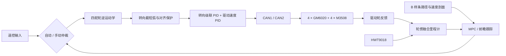

<div align="center">

<h1>STM32 Motion Lab</h1>

<p><strong>从底盘驱动、轮惯里程计到自主路径跟踪的嵌入式移动机器人实践</strong></p>

<p>
  
  
  
  
  
</p>

<p>
  <a href="#项目矩阵">项目矩阵</a> ·
  <a href="#系统闭环">系统闭环</a> ·
  <a href="#快速开始">快速开始</a> ·
  <a href="01_Car_Swerve_Wheels_AutoNavigation/README.md">舵轮 MPC 专题</a>
</p>

</div>

---

这个仓库记录两套全向移动底盘的完整控制链路：一套基于 STM32F407 的麦克纳姆轮自动导航平台，以及一套基于 AT32F403A 的四舵轮自主路径跟踪平台。内容不只包含算法示例，也保留了从传感器、里程计、路径规划，到 CAN 电机闭环和遥控接管的工程实现。

> 当前重点：四舵轮工程已加入三次 B 样条路径、曲率约束速度规划、轻量化运动学 MPC、轮速与 HWT9018 航向融合，以及 MPC/前瞻跟踪器一键回退开关。

## 项目矩阵

| 工程 | 平台与底盘 | 导航链路 | 入口 |
| --- | --- | --- | --- |
| 麦克纳姆轮自动导航 | STM32F407、四轮麦克纳姆底盘、FreeRTOS | 编码器 + MPU6050、贝塞尔路径、前瞻跟踪、四轮速度 PID | [`00_Car_Mecanum_Wheels_AutoNavigation/`](00_Car_Mecanum_Wheels_AutoNavigation/) |
| 四舵轮 MPC 自动导航 | AT32F403A @ 240 MHz、GM6020 转向 + M3508 驱动、双 CAN | 轮速 + HWT9018、三次 B 样条、曲率预减速、嵌入式 MPC | [项目说明](01_Car_Swerve_Wheels_AutoNavigation/README.md) |
| NRF 遥控端 | 独立遥控固件 | 手动速度指令、自动/手动仲裁输入 | [`00_Remote_NRF_Controller/`](00_Remote_NRF_Controller/) |
| 固件与资料 | HEX、学习报告、结构图、演示视频 | 便于复现与理解完整控制链 | [`00_Firmware_HEX/`](00_Firmware_HEX/) · [`docs/`](docs/) |

## 为什么值得看

- 从控制算法落到真实电机：世界坐标速度经过车体坐标变换、底盘逆运动学、转向优化与 PID，最终通过 CAN 输出到八台电机。
- 面向 MCU 资源设计 MPC：固定小预测域、投影梯度求解、速度和加速度约束，不依赖大型优化库。
- 路径与速度协同：B 样条提供连续轨迹，曲率限速和反向制动包络让急弯前主动降速。
- 定位链路可观测：轮速、陀螺、航向锚定、EKF 状态与影子里程计均提供调试量，便于区分控制误差和定位误差。
- 保留工程退路：MPC 可通过编译开关切回原前瞻跟踪器，适合逐项 A/B 实车验证。

## 系统闭环



## 仓库结构

```text
STM32-Project/
├─ 00_Car_Mecanum_Wheels_AutoNavigation/   # STM32F407 麦轮车端
├─ 00_Remote_NRF_Controller/                # NRF 遥控端
├─ 00_Firmware_HEX/                         # 已发布固件
├─ 01_Car_Swerve_Wheels_AutoNavigation/     # AT32F403A 四舵轮车端
└─ docs/                                    # 报告、配图与视频
```

## 快速开始

```bash
git clone https://github.com/lzy9760/STM32-Project.git
cd STM32-Project
```

### 四舵轮工程

1. 安装 Keil MDK5、Arm Compiler 5，并准备 AT32F403A/407 固件库。
2. 打开 `01_Car_Swerve_Wheels_AutoNavigation/mdk_v5/duolun_test.uvprojx`。
3. 将工程中的 AT32 驱动与 CMSIS 绝对路径改为你的本机路径。
4. 选择 `template` Target 后 Build；下载前先确认电机 ID、CAN 映射、转向零位和轮径参数与实车一致。

完整的算法、参数与调试入口见 [四舵轮 MPC 自动导航说明](01_Car_Swerve_Wheels_AutoNavigation/README.md)。

### 麦克纳姆轮工程

麦轮工程的详细原理、任务调度和定位推导保留在 [技术学习报告](docs/mecanum-navigation-technical-report.md)，原始 PDF 与演示素材位于 [`docs/`](docs/)。

## 演示资料

<p align="center">
  <a href="docs/videos/navigation_teaching_video_fontsafe_1080p60.mp4">
    
  </a>
</p>

<p align="center"><a href="docs/videos/navigation_teaching_video_fontsafe_1080p60.mp4">点击查看完整教学视频</a></p>

## 使用前请注意

- 这是面向特定实车标定的开发工程，不同轮径、减速比、电机方向、安装角和 IMU 朝向必须重新校准。
- 自动导航属于实验性功能。首次运行请架空车轮或设置物理急停，随后以低速、单变量方式逐项验证。
- 仓库未打包第三方 AT32/STM32 厂商库；请遵守相应 SDK 与器件包许可。
- 根目录当前未声明开源许可证；除非另有说明，代码权利仍归原作者所有。

## 文档索引

- [四舵轮 MPC 自动导航：算法、参数与调试](01_Car_Swerve_Wheels_AutoNavigation/README.md)
- [麦克纳姆轮自动导航技术报告](docs/mecanum-navigation-technical-report.md)
- [原始学习报告 PDF](docs/学习报告-刘知渊.pdf)

---

<div align="center">
  <sub>如果这个项目对你的底盘控制、定位融合或嵌入式 MPC 实践有帮助，欢迎 Star 并基于实车数据继续迭代。</sub>
</div>
