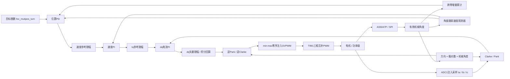

<div align="center">

# MY_FOC · 有感FOC与多圈伺服控制

**ADC同步电流闭环 × 角度跟踪速度观测器 × 增量式多圈位置反馈**


基于STM32F405、DRV8323和磁编码器的PMSM/BLDC有感控制实验工程。

[算法架构](#算法架构) · [核心算法](#核心算法) · [参数配置](#参数配置) · [编译运行](#编译运行) · [测试与状态](#测试与状态) · [来源与许可](#来源与许可)

</div>

## 项目定位

MY_FOC面向从电流控制到位置伺服的完整嵌入式实现：在STM32F405上完成三相电流采集、坐标变换、dq电流PI、SVPWM、编码器速度估计和相对多圈位置控制，并提供标定、Flash记录及故障诊断通路。

本项目的实现重点是**控制链与采样时序的一致性、角度差分噪声与反馈延迟之间的取舍，以及多圈机械位置的连续表达**。源码可直接定位算法入口，外设初始化、控制计算和调试传输各自有明确的执行路径。

```text
相对多圈位置目标
        ↓
位置PD → 有限幅的机械速度目标
        ↓
速度PI → 有限幅的Iq目标
        ↓
ADC同步dq电流PI → 电压矢量限幅
        ↓
逆Park / 逆Clarke → 零序注入SVPWM → 三相互补PWM
```

> **默认配置会运动。** 当前源码允许上电进入闭环，并请求相对启动位置正转8圈，速度上限50 rad/s。首次移植应先在`motor1_drive.h`中关闭`FOC_ENABLE_POWER_ON_MOTION`，核对采样、相序、驱动及编码器配置。仓库保留当前调试参数，没有为发布而静默修改电机行为。

## 实现特点

| 模块 | 本项目的具体实现 |
|---|---|
| 电流闭环 | TIM1_CC4触发ADC注入序列，电流环在转换完成回调中执行 |
| 速度反馈 | 机械角度预测/校正跟踪环，按实际dt更新，速度状态供速度PI使用 |
| 多圈位置 | 对跨零修正后的机械角度增量作有符号累计，内部double、外部float观测接口 |
| 位置调节 | 位置误差输出速度参考，叠加基于观测速度的阻尼，限幅后进入速度PI |
| 电压饱和处理 | dq电压矢量限幅，试运行模式下回算电流PI积分状态 |
| 对齐标定 | 非阻塞正反扫描、方向/极对数检查、圆周平均候选offset和七点核验 |
| 标定保存 | 32字节记录、CRC32、配置/已验证标志、提交字最后写入、保存后回读 |
| 诊断 | USB CDC十通道JustFloat、周期统计、首故障锁存和DRV8323故障快照 |

FOC、PI/PD、SVPWM和角度跟踪环均是成熟控制方法。这里突出本工程的离散实现与系统集成；参考来源和第三方代码不声明为项目原创。

## 算法架构



### 执行周期与职责

| 执行层 | 周期/触发方式 | 职责 |
|---|---|---|
| 电流环 | 名义20 kHz，ADC转换完成回调 | dq变换、电流PI、电压限幅、PWM更新、快速电流保护 |
| 速度观测器 | 前台约1 ms，新角度且满足最小间隔后执行 | 时间戳、角度预测/校正、速度估计 |
| 位置环与速度环 | 前台约2 ms，位置环先于速度环 | 位置累计、速度目标、Iq目标 |
| USB发送 | 前台服务 | 批量发送已采集的诊断帧 |
| 对齐状态机 | 前台推进，电流调节由ADC回调执行 | 电流渐增、扫描、核验和保存门控 |

约1 ms/2 ms是软件调度条件，不是RTOS硬实时保证。观测器使用DWT实测dt；运行电流PI与速度PI的Ki按每次调用累加，改变周期时应重新理解等效积分强度。

## 核心算法

### 1. ADC同步dq电流闭环

三相电流由ADC1注入序列获得。启动零偏标定完成后，当前板级换算为：

```math
i_{a,b,c}=(ADC_{a,b,c}-offset_{a,b,c})\cdot0.0403\quad[\mathrm{A}]
```

Clarke变换采用两相表达，第三相保留作诊断：

```math
i_\alpha=i_a,\qquad i_\beta=\frac{i_a+2i_b}{\sqrt3}
```

```math
i_d=i_\alpha\cos\theta_e+i_\beta\sin\theta_e,\qquad
i_q=-i_\alpha\sin\theta_e+i_\beta\cos\theta_e
```

电角度来自原始有效机械角度，而非观测器平滑后的角度：

```math
\theta_e=\mathrm{wrap}_{2\pi}\!\left[d\,p\,(\theta_m-\theta_{offset})\right]
```

其中方向`d=foc_dir`，极对数`p=foc_pp`。当前配置为XC5000 KV380、7极对、编码器直连。

两轴PI输出经过统一电压矢量约束，保持方向并按比例缩放：

```math
\sqrt{u_d^2+u_q^2}\le U_{max}
```

试运行模式按最终受限电压回算对应积分状态，减少电流环在电压天花板后继续积累。该处理与速度环的积分限幅不同，不能将各层级视作同一个完整抗饱和器。

**入口：** [`foc_curr_loop_nb()`](MY_FOC/Core/Src/foc.c)、[`HAL_ADCEx_InjectedConvCpltCallback()`](MY_FOC/Core/Src/main.c)。

### 2. 预测/校正式速度观测器

对相邻角度直接差分可得到速度，但角度噪声也会被除以短dt；增加低通滤波又会引入反馈延迟。本工程根据Microchip MCAF角度跟踪环方程，以角度、速度两个状态完成离散预测/校正。

每次有效更新计算：

```math
\theta_{pred}=\hat{\theta}+\hat{\omega}\Delta t,\qquad
e=\mathrm{wrap}_{\pm\pi}(\theta_m-\theta_{pred})
```

```math
q=e^{-2\pi f_n\Delta t}
```

```math
\hat{\omega}\leftarrow\hat{\omega}+\frac{(1-q)^2}{\Delta t}e,\qquad
\hat{\theta}\leftarrow\mathrm{wrap}_{2\pi}\!\left[\theta_{pred}+(1-q^2)e\right]
```

离散误差系统具有两个相同极点`q`；小dt极限对应临界阻尼跟踪模型。当前自然频率`f_n=60 Hz`，不代表60 Hz的−3 dB带宽。速度环使用速度状态输出，没有再串联原有一阶低通。

- 用`enc_valid_count`排除重复样本，按实际DWT间隔约1 ms更新。
- 长间隔超过20 ms时重新初始化，避免调试暂停后产生速度尖峰。
- 保留原始差分速度、角度残差和实际dt供对照。
- 观测器具有有限相位延迟；速度曲线变平滑不能单独证明机械速度更平稳。

**入口：** [`foc_update_speed()`](MY_FOC/Core/Src/foc.c)。

### 3. 增量式多圈机械位置

位置反馈使用连续机械角度增量，不把累计位置折回单圈：

```math
\Delta\theta_k=\mathrm{wrap}_{\pm180^\circ}(\theta_k-\theta_{k-1}),\qquad
\Theta_k=\Theta_{k-1}+d\,\Delta\theta_k
```

内部用double累计，外部提供float总角度和圈数接口。359°→1°累计+2°，1°→359°累计−2°。首次有效样本建立相对零点，复位后重新计数。

```math
N=\frac{\Theta}{360^\circ},\qquad e_\theta=2\pi(N_{target}-N)
```

位置PD输出机械速度参考：

```math
\omega_{ref}=\mathrm{sat}\left(K_{p,pos}e_\theta-K_{d,pos}\hat{\omega},
-\omega_{max},+\omega_{max}\right)
```

阻尼项使用已有观测速度，没有再次差分位置误差。这里的Kd是速度参考层的阻尼系数，并非直接输出转矩的PID微分增益。

目标2圈对应720°，8圈对应2880°。支持正反方向及小数圈，完成后继续闭环保持；原有运行超时保护仍有效。软件多圈状态不持久化，不能恢复断电期间运动。

**入口：** [`foc_pos_loop_nb()`](MY_FOC/Core/Src/foc.c)。

### 4. min-max零序注入SVPWM

dq电压经逆Park、逆Clarke得到三相参考后，计算：

```math
u_0=-\frac{\max(u_a,u_b,u_c)+\min(u_a,u_b,u_c)}{2}
```

三相统一叠加零序分量，再转换为CCR1～CCR3。该方法与扇区作用时间法具有对应关系，源码无需逐扇区计算正弦作用时间。

当前占空比换算使用固定24 V母线标度和4200计数跨度。它是本板配置，不包含实时母线电压补偿，移植时需要核对。

### 5. 双向对齐与可信标定记录

对齐模块适配VESC的编码器检测思路，以受控电流建立定子磁场，通过方向/比例检查和正反扫描形成候选offset。扫描误差采用圆周平均，避免0°/360°附近普通算术平均失效：

```math
\bar{\delta}=\mathrm{atan2}\left(\sum\sin\delta_k,\sum\cos\delta_k\right),\qquad
R=\frac{\sqrt{(\sum\sin\delta_k)^2+(\sum\cos\delta_k)^2}}{n}
```

候选值随后经过0°→120°→240°→360°→240°→120°→0°核验。验证和保存门控通过后，才允许提交带CRC的Flash记录。

**默认走候选offset试运行路径，跳过扫描、Flash加载与保存。** 代码具备保存能力，不等于当前上电已经完成可信自动标定。

**入口：** [`motor1_drive.c`](MY_FOC/Core/Src/motor1_drive.c)，流程与Flash格式见[接入文档](MY_FOC/docs/bringup.md)。

## 参数配置

以下为2026-11-08上传的源码快照值，供复现当前状态，不是其它电机的推荐整定参数。

| 参数 | 当前值 | 修改位置 |
|---|---:|---|
| 相对目标圈数`foc_mutipos_turn` | 8.0 | `Core/Src/foc.c` |
| 位置Kp / Kd | 20.0 / 0.4 | `Core/Src/foc.c` |
| 速度PI Kp / 每次调用Ki | 0.28 / 0.006 | `Core/Src/foc.c` |
| Id、Iq PI Kp / 每次调用Ki | 0.1 / 0.003 | `Core/Src/foc.c` |
| 观测器自然频率`FOC_SPEED_HZ` | 60 Hz | `Core/Src/foc.c` |
| 速度参考上限 | 50 rad/s | `Core/Inc/motor1_drive.h` |
| 速度环Iq输出限幅 | ±3 A | 同上 |
| 运行电压矢量限幅 | 2 V | 同上；启动检查也限制不超过2 V |
| 候选机械offset | 4.72575378° | 同上，仅适用于当前安装 |
| 极对数 / 编码器方向 | 7 / +1 | `foc.c`与`motor1_drive.h` |

```c
// 相对启动零点：正转两圈、反转两圈、正转四分之一圈
#define foc_mutipos_turn  2.0f
// #define foc_mutipos_turn -2.0f
// #define foc_mutipos_turn  0.25f
```

若需肉眼核实8圈，可单独将速度上限降为`6.283185f` rad/s，约1圈/秒。比较前后效果时保持其他参数一致。

## 编译运行

```bash
git clone --branch MY_FOC --single-branch https://github.com/lzy9760/STM32-Project.git
cd STM32-Project/MY_FOC
```

1. 使用Keil MDK5打开`MDK-ARM/XC5000_FOC.uvprojx`，选择`XC5000_FOC` Target。
2. 安装Arm Compiler 5；原工程使用V5.06 update 5。器件为STM32F405RGTx，需要对应STM32F4器件支持包。
3. 核对引脚和自己的电调，先关闭上电运动，再检查采样零偏、相序、方向和驱动状态。
4. 编译后核对程序Flash范围，保留sector 11标定区；重新标定安装相关offset。
5. 开启运动前确认目标及速度、电流、电压限幅。观察首故障值，避免将停机后的状态误认为首次停机原因。

仓库包含本工程使用的HAL、CMSIS头文件、USB Device Library和启动文件；省略未使用的CMSIS DSP/文档、历史备份、RAM/Flash转储、个人IDE状态和生成的AXF/HEX。当前CubeMX工程含手工扩展的调度与保护逻辑，重新生成前应检查差异。

## 测试与状态

### 可复现主机测试

安装Python 3和GCC后，在`MY_FOC/`目录运行：

```bash
python tests/run_host_tests.py
```

测试编译当前`foc.c`，外设寄存器由主机桩替代，不连接ST-Link、不复位、不运行电机。覆盖：

- 正反方向、跨零、重复/无效样本、实际dt及计时器回绕。
- 观测器对模拟角度噪声、加速及5/10/20 Hz速度变化的响应。
- 多圈、小数圈、角度增量累计、360°/720°及复位零点。
- 速度限幅、停机抢占、位置先于速度的2 ms调用顺序。
- 37个Keil源文件路径和17个Core源码快照哈希。

固定1 ms采样的合成输入下，当前60 Hz观测器结果为：

| 速度变化频率 | 等效相位延迟 | 幅值比 |
|---|---:|---:|
| 5 Hz | 约4.86 ms | 约0.993 |
| 10 Hz | 约4.82 ms | 约0.973 |
| 20 Hz | 约4.68 ms | 约0.901 |

这是指定输入下的软件测试，不包含实际SPI采样年龄、前台调度抖动、内环动态和负载变化。完整输出由脚本生成到被Git忽略的`tests/.build/`。

### 台架观察与验证边界

| 内容 | 当前状态 |
|---|---|
| Keil构建 | 本地已有0 Error / 0 Warning记录；本次上传整理未重新烧录 |
| 速度反馈处理 | 台架反馈表明，旁路强低通并加入跟踪观测器后，卡滞和速度波动有所改善 |
| 位置阻尼 | 台架反馈表明加入速度阻尼后，到位摆动减轻 |
| 减速末段 | 仍可能有轻微卡滞，摩擦、齿槽扰动和控制指令之间的影响尚未完全分离 |
| 8圈累计 | 用户观察到编码器累计反馈2880°；独立机械标记计圈仍需完成 |
| 机械误差小于0.5° | 调试目标，尚无独立验收数据，不作为性能保证 |
| 跨电机/跨电调移植 | 尚未验证，不能直接复用offset、采样增益及控制参数 |

## 遥测与调试

USB CDC使用十通道JustFloat协议，名义采样率5 kHz。当前CH3～CH5为诊断映射，非PWM占空比：

| 通道 | 数据 | 单位 |
|---|---|---|
| CH0 / CH1 / CH2 | Ia / Ib / Ic | A |
| CH3 | 编码器机械角度 | deg |
| CH4 | 原始差分速度 | rad/s |
| CH5 | dq输出电压幅值 | V |
| CH6 / CH7 | 目标机械速度 / 观测机械速度 | rad/s |
| CH8 / CH9 | 目标Iq / 实际Iq | A |

Watch常用变量：

```text
foc_pos_deg / foc_pos_turn / foc_target_pos_turn / foc_pos_error_turn
foc_speed_rad_s / foc_speed_raw_rad_s / foc_speed_error_deg / foc_speed_dt_s
foc_target_iq / foc_iq / foc_ud / foc_uq
foc_current_loop_count / foc_current_loop_period_cycles / foc_current_loop_max_cycles
motor_safety_fault / motorVars_M1.faultMtrNow
enc_valid_count / enc_spi_fail / enc_parity_fail / enc_glitch_count
debug_sample_hz / debug_dropped / debug_skipped
```

多圈控制使用累计机械角度，电流环使用电角度，两者不能混用。读取旧值也不能证明采样仍在更新；DWT依赖和故障号说明见[接入与诊断文档](MY_FOC/docs/bringup.md)。

## 工程结构

```text
MY_FOC/
├── Core/                       控制器、编码器、驱动、外设与保护
├── Drivers/                    HAL及CMSIS头文件
├── MDK-ARM/                    Keil工程、启动文件与Flash布局
├── USB_Device/                 USB设备和CDC实现
├── tests/                      实际控制源码的主机测试及外设桩
├── docs/                       接入文档和Core源码快照哈希
├── telemetry/vesc_encoder_reference_20261107/
│                               对齐参考版本与GPL原文
├── XC5000_FOC.ioc              CubeMX配置快照
└── THIRD_PARTY_NOTICES.md       参考算法与第三方许可说明
```

| 代码入口 | 职责 |
|---|---|
| [`foc.c`](MY_FOC/Core/Src/foc.c) | 位置PD、速度PI、观测器、电流PI、坐标变换和SVPWM |
| [`main.c`](MY_FOC/Core/Src/main.c) | 启动门控、ADC回调、控制调度、零偏标定和安全停机 |
| [`motor1_drive.c`](MY_FOC/Core/Src/motor1_drive.c) | 对齐状态机、offset核验和Flash事务 |
| [`encoder.c`](MY_FOC/Core/Src/encoder.c) | AS5047P流水SPI读取、校验、角度换算和DWT等待 |
| [`drv8323.c`](MY_FOC/Core/Src/drv8323.c) | DRV8323配置、回读和故障快照 |
| [`debug.c`](MY_FOC/Core/Src/debug.c) | 通道采集、环形缓冲和前台USB发送 |

## 来源与许可

- **速度观测器方程参考：** [Microchip MCAF Tracking loop](https://microchiptech.github.io/mcaf-doc/6.0.2/algorithms/qei.html#tracking-loop)。本项目按实际dt作离散适配，并非直接复制其SDK。
- **编码器对齐适配来源：** [Benjamin Vedder / VESC，固定commit](https://github.com/vedderb/bldc/blob/2392b4b8483adecc81c87ccabcaca968efc50d60/motor/mcpwm_foc.c)。相关模块原有GPL-3.0-or-later声明及GPL文本已保留。
- **厂商库与原有声明：** ST HAL、USB库、Arm CMSIS及原有TI文件头均保留，见[THIRD_PARTY_NOTICES](MY_FOC/THIRD_PARTY_NOTICES.md)。

本分支新增`MY_FOC/`并更新首页，仓库其他工程目录保留。其他机器人项目可查看[`main`分支](https://github.com/lzy9760/STM32-Project/tree/main)。
